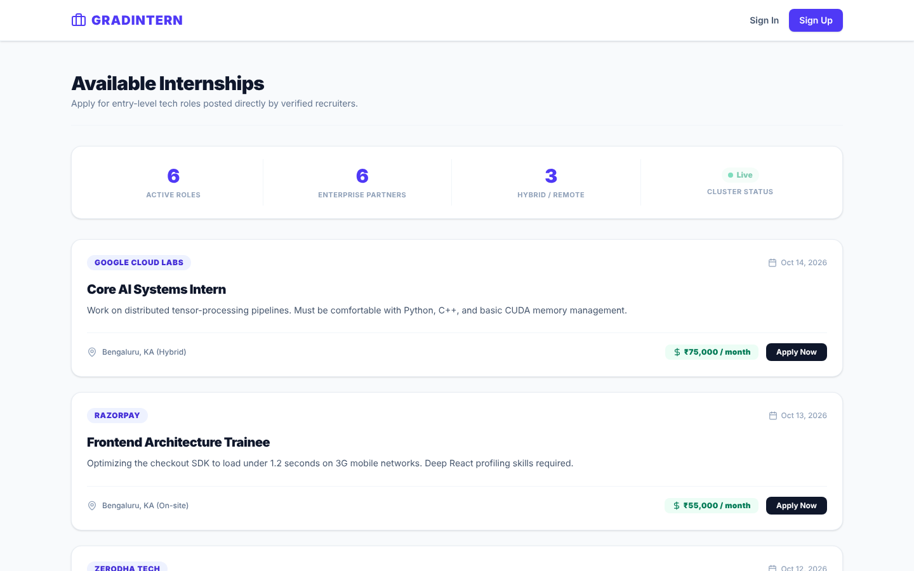
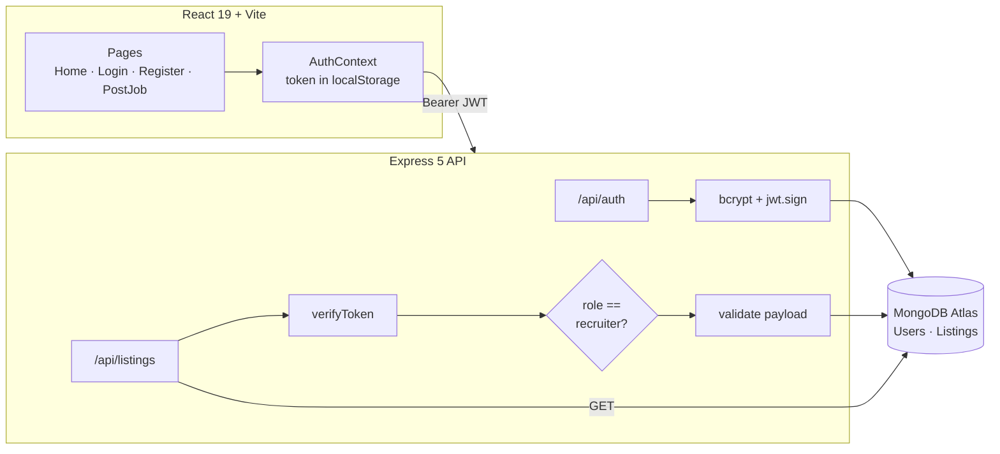
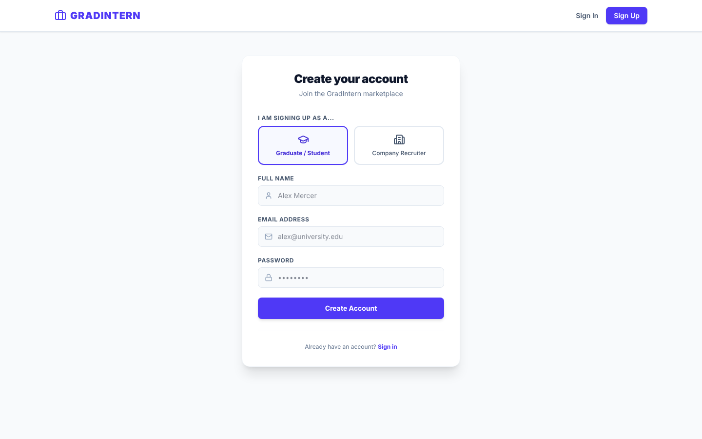
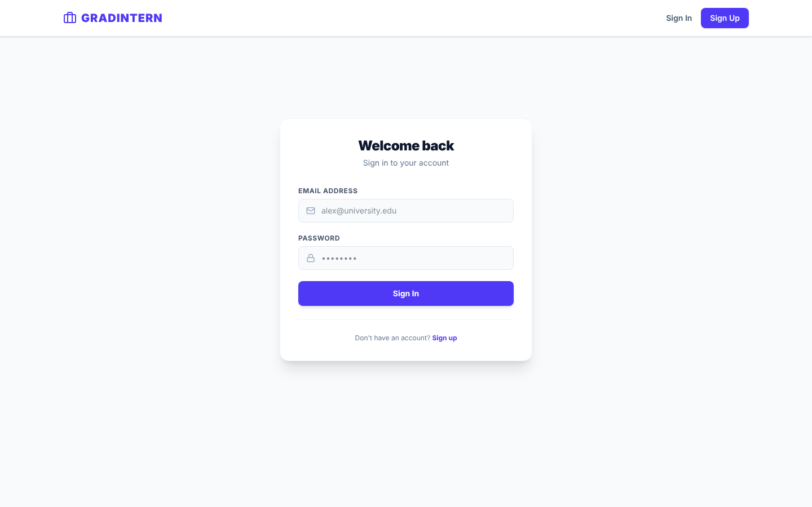

<div align="center">

# 🎓 GradIntern

### Full-stack internship marketplace with role-based access control

Graduates browse and apply. Recruiters post roles. The API enforces who can do what.

[](https://github.com/SlazzInC0de/gradintern/actions/workflows/ci.yml)




</div>

---

**Contents:** [Features](#-features) · [Access matrix](#-access-matrix) · [Architecture](#️-architecture) · [Tests and evidence](#-tests-and-evidence) · [Design decisions](#-design-decisions) · [Screenshots](#-screenshots) · [Run locally](#-run-locally) · [Environment variables](#️-environment-variables) · [Project structure](#-project-structure) · [Roadmap](#️-roadmap) · [Security and privacy](#-security-and-privacy) · [License](#-license)

---

## ✨ Features

- 🔐 **JWT authentication** with bcrypt-hashed passwords and 1-day tokens
- 🛂 **Role-based access control**: custom Express middleware verifies the Bearer token, then each route checks the role
- 🧾 **Payload validation** on job posts (types, lengths, required fields) before anything reaches Mongoose
- 🔄 **Persistent sessions**: a React `AuthContext` rehydrates the user from `localStorage` on reload
- 🌐 **Environment-aware API base URL** via `VITE_API_URL`, so the same build works locally and in production
- 📊 **Live board stats**: active roles, partner companies and hybrid/remote count computed on the client

## 🛂 Access matrix

| Action | Endpoint | Guest | 🎓 Grad | 👔 Recruiter |
|---|---|:---:|:---:|:---:|
| Register | `POST /api/auth/register` | ✅ | ✅ | ✅ |
| Log in | `POST /api/auth/login` | ✅ | ✅ | ✅ |
| Browse jobs | `GET /api/listings` | ✅ | ✅ | ✅ |
| Post a job | `POST /api/listings` | ❌ `401` | ❌ `403` | ✅ |

## 🏛️ Architecture



## 🧪 Tests and evidence

**15 API tests** run on every push with Node's built-in test runner. MongoDB is replaced by in-memory stubs, so the suite needs no database.

| Area | What is checked |
|---|---|
| Auth | bcrypt hashing, duplicate email, wrong password and unknown email return the same error |
| RBAC | no token `401`, forged or expired token `403`, grad posting `403`, recruiter posting `201` |
| Validation | short or long title, non-string company, short description, missing salary or location, `413` on bodies over 100 kB |
| Failure handling | a database error returns `500` with a generic message and no stack trace |

**Coverage** (`npm test`): 100% lines and branches across `routes/`, `middleware/` and `models/`. `server.js` only wires up the app and opens the DB connection, so it is not exercised by the suite.

### ⏱️ Auth benchmark

`npm run bench` measures the request path with the database write stubbed out, so only the API layer is timed. Results from one run on a 2 vCPU Xeon @ 2.1 GHz, Node 22:

| Operation | p50 | p95 | p99 |
|---|---:|---:|---:|
| `jwt.verify` (HS256), 10k calls | 0.03 ms | 0.07 ms | 0.12 ms |
| `POST /api/listings` as recruiter: verify + RBAC + validation, `201` | 0.97 ms | 1.36 ms | 3.74 ms |
| `POST /api/listings` as grad: rejected by RBAC, `403` | 0.49 ms | 0.71 ms | 1.23 ms |

Token checks are not the bottleneck: in production, request time is dominated by the MongoDB round trip. CI re-runs the benchmark and publishes the numbers in each run's summary.

## 🧭 Design decisions

| Decision | Why | Trade-off / alternative |
|---|---|---|
| **Stateless JWT** (1-day expiry) instead of server sessions | No session store; any API instance can verify a request | A token cannot be revoked before it expires. A denylist or short-lived access + refresh tokens would fix that |
| **Role inside the token**, checked per route | One middleware for identity, explicit role checks where they matter | A role change only takes effect on next login |
| **Hand-written validation middleware** | Zero extra dependencies and clear error messages | A schema library (Zod, Joi) scales better as forms grow |
| **Same error for unknown email and wrong password** | Does not reveal which emails are registered | Slightly less helpful to genuine users |
| **Token in `localStorage`** | Simple rehydration on reload | Readable by injected scripts; an `httpOnly` cookie would be safer against XSS |
| **100 kB JSON body cap** | Cheap protection against oversized payloads | Large descriptions need a higher limit |
| **Generic `500` messages** | Internals and stack traces never reach the client | Debugging relies on server logs |

## 📸 Screenshots

| Sign up with a role | Sign in |
|---|---|
|  |  |

## 🚀 Run locally

**Prerequisites:** Node.js 18+ and a MongoDB Atlas (or local MongoDB) connection string.

```bash
git clone https://github.com/SlazzInC0de/gradintern.git
cd gradintern
```

**1. API**

```bash
cd backend
cp .env.example .env        # fill in MONGO_URI and a random JWT_SECRET
npm install
npm run seed                # optional: sample listings
npm run dev                 # http://localhost:5005
```

**2. Frontend** (new terminal)

```bash
cd frontend
npm install
npm run dev                 # http://localhost:5173
```

Set `VITE_API_URL` in `frontend/.env` when the API is not on `http://localhost:5005`.

**3. Tests and benchmark**

```bash
cd backend
npm test                    # 15 API tests + coverage, no database needed
npm run bench               # auth-path latency
```

**4. Smoke-test against a running API**

```bash
cd backend
npm run smoke:register      # create a grad user
npm run smoke:login         # prints a JWT
GRAD_TOKEN=<jwt> npm run smoke:rbac   # expect 403: grads cannot post
```

## ⚙️ Environment variables

| Variable | Where | Purpose |
|---|---|---|
| `MONGO_URI` | backend | MongoDB connection string |
| `JWT_SECRET` | backend | Secret used to sign tokens |
| `PORT` | backend | API port (default `5005`) |
| `CLIENT_URL` | backend | Deployed frontend origin allowed by CORS |
| `VITE_API_URL` | frontend | Base URL of the API |

## 📁 Project structure

```text
gradintern/
├── backend/
│   ├── middleware/verifyToken.js   # Bearer token -> req.user
│   ├── models/                     # User (grad | recruiter), Listing
│   ├── routes/                     # auth, listings (RBAC + validation)
│   ├── scripts/                    # seed, smoke tests, auth benchmark
│   ├── test/                       # node:test API suite
│   └── server.js
├── frontend/
│   └── src/
│       ├── context/AuthContext.jsx
│       ├── pages/                  # Home, Login, Register, PostJob
│       └── config.js               # API base URL
└── docs/screenshots/
```

## 🗺️ Roadmap

- [ ] Applications collection so "Apply" persists per user
- [ ] Recruiter dashboard to edit and close listings
- [ ] Rate limiting and `helmet` on the API
- [ ] Deploy (Render for the API, Vercel for the client)

## 🔒 Security and privacy

- Passwords are hashed with bcrypt, tokens expire after 1 day, and every write route is checked by role on the server.
- Secrets (`MONGO_URI`, `JWT_SECRET`) live only in `backend/.env`, never in the repo.
- [PRIVACY.md](PRIVACY.md) explains what user data is stored (name, email, role) and how to get it deleted.
- Found a vulnerability? Please report it privately as described in [SECURITY.md](SECURITY.md).

## 📄 License

MIT © [Suryansh Verma](https://github.com/SlazzInC0de)
