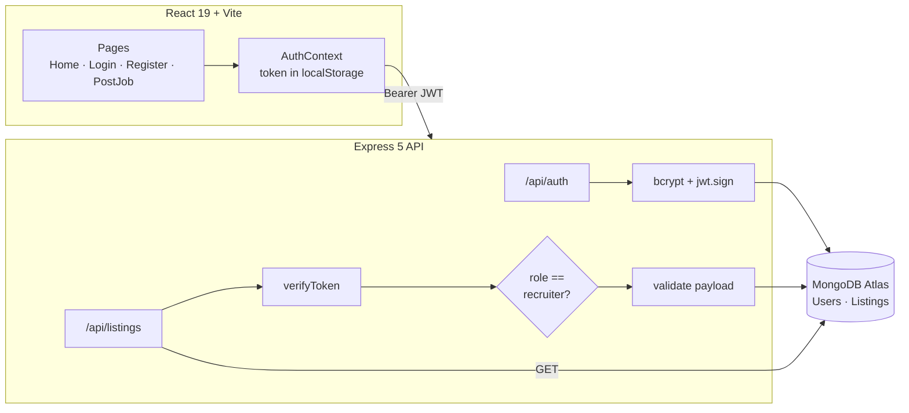

<div align="center">

# 🎓 GradIntern

### Full-stack internship marketplace with role-based access control

Graduates browse and apply. Recruiters post roles. The API enforces who can do what.


</div>

---

## ✨ Features

- 🔐 **JWT authentication** with bcrypt-hashed passwords and 1-day tokens
- 🛂 **Role-based access control**: custom Express middleware verifies the Bearer token, then each route checks the role
- 🧾 **Payload validation** on job posts (types, lengths, required fields) before anything reaches Mongoose
- 🔄 **Persistent sessions**: a React `AuthContext` rehydrates the user from `localStorage` on reload
- 🌐 **Environment-aware API base URL** via `VITE_API_URL`, so the same build works locally and in production
- 📊 **Live board stats**: active roles, partner companies and hybrid/remote count computed on the client

## 🛂 Access matrix

| Action | Endpoint | Guest | 🎓 Grad | 👔 Recruiter |
|---|---|:---:|:---:|:---:|
| Register | `POST /api/auth/register` | ✅ | ✅ | ✅ |
| Log in | `POST /api/auth/login` | ✅ | ✅ | ✅ |
| Browse jobs | `GET /api/listings` | ✅ | ✅ | ✅ |
| Post a job | `POST /api/listings` | ❌ `401` | ❌ `403` | ✅ |

## 🏛️ Architecture



## 📸 Screenshots

| Sign up with a role | Sign in |
|---|---|
|  |  |

## 🚀 Run locally

**Prerequisites:** Node.js 18+ and a MongoDB Atlas (or local MongoDB) connection string.

```bash
git clone https://github.com/SlazzInC0de/gradintern.git
cd gradintern
```

**1. API**

```bash
cd backend
cp .env.example .env        # fill in MONGO_URI and a random JWT_SECRET
npm install
npm run seed                # optional: sample listings
npm run dev                 # http://localhost:5005
```

**2. Frontend** (new terminal)

```bash
cd frontend
npm install
npm run dev                 # http://localhost:5173
```

Set `VITE_API_URL` in `frontend/.env` when the API is not on `http://localhost:5005`.

**3. Smoke-test RBAC**

```bash
cd backend
npm run smoke:register      # create a grad user
npm run smoke:login         # prints a JWT
GRAD_TOKEN=<jwt> npm run smoke:rbac   # expect 403: grads cannot post
```

## ⚙️ Environment variables

| Variable | Where | Purpose |
|---|---|---|
| `MONGO_URI` | backend | MongoDB connection string |
| `JWT_SECRET` | backend | Secret used to sign tokens |
| `PORT` | backend | API port (default `5005`) |
| `CLIENT_URL` | backend | Deployed frontend origin allowed by CORS |
| `VITE_API_URL` | frontend | Base URL of the API |

## 📁 Project structure

```text
gradintern/
├── backend/
│   ├── middleware/verifyToken.js   # Bearer token -> req.user
│   ├── models/                     # User (grad | recruiter), Listing
│   ├── routes/                     # auth, listings (RBAC + validation)
│   ├── scripts/                    # seed + smoke tests
│   └── server.js
├── frontend/
│   └── src/
│       ├── context/AuthContext.jsx
│       ├── pages/                  # Home, Login, Register, PostJob
│       └── config.js               # API base URL
└── docs/screenshots/
```

## 🗺️ Roadmap

- [ ] Applications collection so "Apply" persists per user
- [ ] Recruiter dashboard to edit and close listings
- [ ] Rate limiting and `helmet` on the API
- [ ] Jest + Supertest suite for the auth and RBAC paths
- [ ] Deploy (Render for the API, Vercel for the client)

## 📄 License

MIT © [Suryansh Verma](https://github.com/SlazzInC0de)
